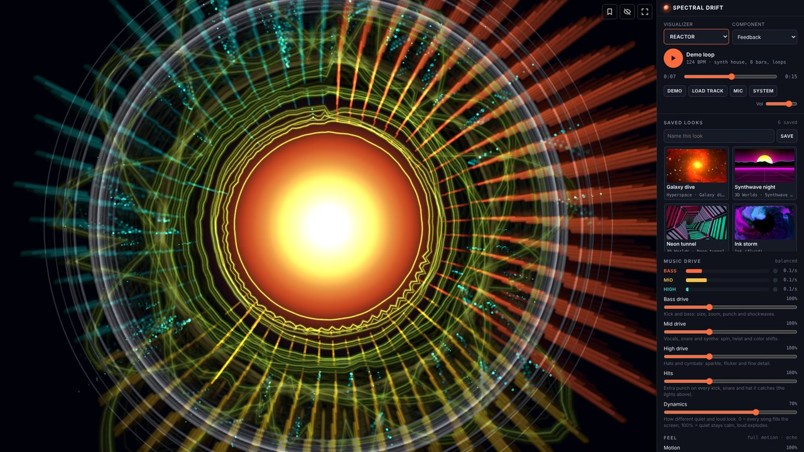

# Spectral Drift

A Winamp-style music visualizer that turns whatever you're playing into living visuals.

**Try it in your browser:** https://aaronaudio09.github.io/spectral-drift/

**Windows app (free):** [Microsoft Store](https://apps.microsoft.com/detail/9P8FM3XZN945)

## What it does

Ten visualizers: Hyperspace (endless zooms through space or your own picture), 3D Worlds (ten scenes drawn on your graphics card), Ink (a real fluid simulation you stir with the mouse), Swarm, Mandala, Laser show, over 200 classic MilkDrop presets, an AVS-style effect builder, the Classic analyzer and Reactor.

Bass, mid and high each drive the picture their own way, kicks, snares and hats hit harder, and Dynamics decides how calm quiet music looks. Save any picture you like as a named look and bring it back later.

## On a Mac

Use Chrome or Edge. Press ▶ for the built-in demo, load a track, or click **Mic**. To visualize what your Mac is playing (Spotify, YouTube…), click **System** and share your screen with **Share system audio** turned on; that needs Chrome 141 or newer on macOS 14.2 or newer. The video is dropped straight away; nothing is recorded or uploaded.

## Keys

Space play/pause · N / P next/previous · R random · E next visualizer · F fullscreen · H hide controls · S save the look on screen

No accounts, no ads, no tracking. Made by Aaron Does It.
